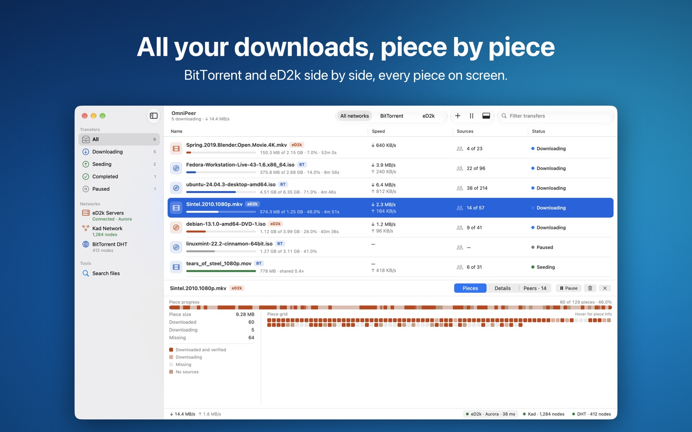
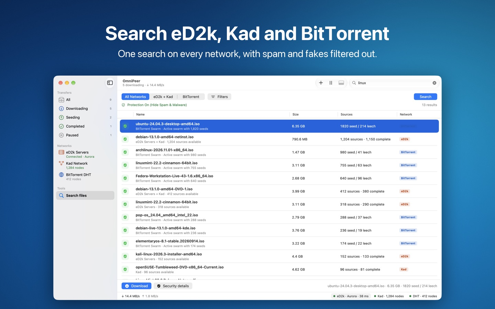
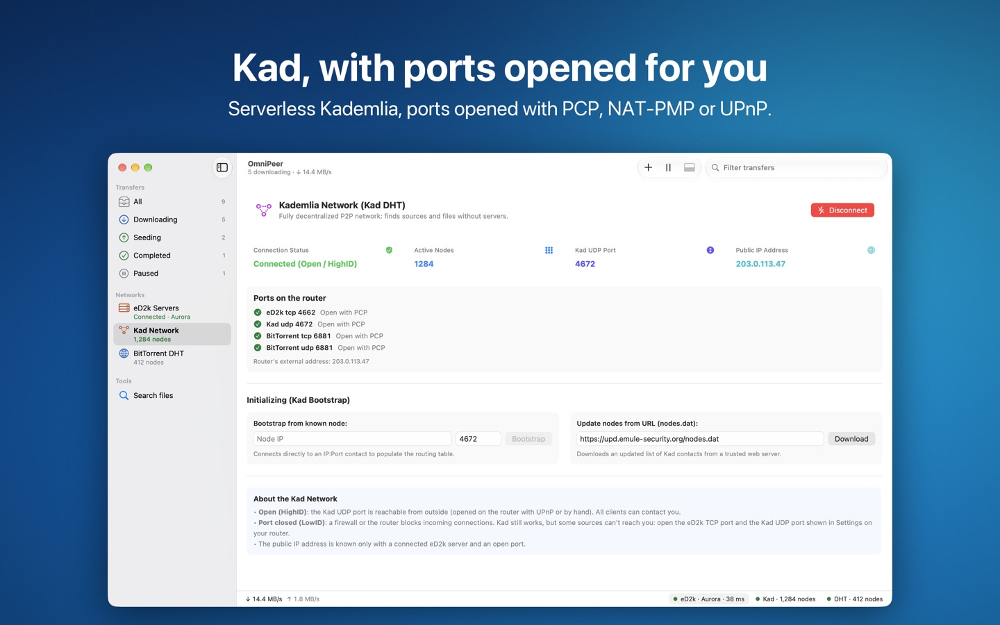
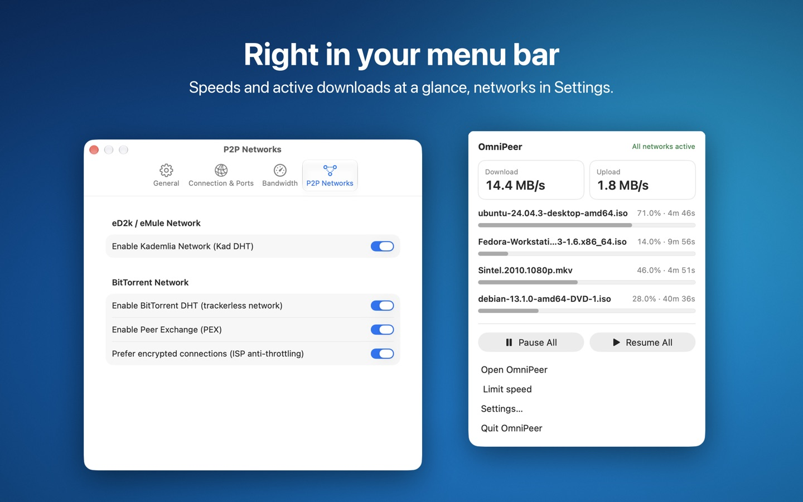
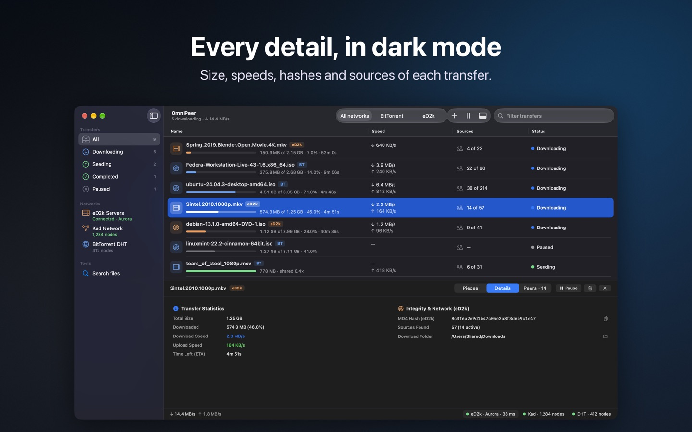

# OmniPeer

**eD2k, Kad e BitTorrent in un'unica app nativa per Mac** 
**eD2k, Kad, and BitTorrent in one native Mac app**

[Pagina del progetto](https://dimpemekug.com/progetti/omnipeer/) ·
[Documentazione](https://dimpemekug.com/progetti/omnipeer/docs/) ·
[Privacy](https://dimpemekug.com/progetti/omnipeer/privacy/)

[🇮🇹 Italiano](#-italiano) · [🇬🇧 English](#-english)

---

## 🇮🇹 Italiano

OmniPeer è un client peer-to-peer per Mac che mette insieme la rete eD2k (server e Kad) e la rete
BitTorrent in un'unica finestra. Incolli un link magnet o ed2k, oppure scegli un file `.torrent`, e
OmniPeer riconosce da solo la rete. Il download si segue pezzo per pezzo su una barra a blocchi.

Gratuita, senza pubblicità, senza account e senza acquisti in-app.

### Funzioni

- **Un link, qualsiasi rete**: link magnet, link ed2k e file `.torrent`. I link aperti dal browser e
  i `.torrent` aperti nel Finder o trascinati sul Dock arrivano direttamente nell'app.
- **Ogni pezzo sotto controllo**: barra a blocchi, griglia dei pezzi, fonti e peer con il loro
  client; per eD2k gli hash MD4 e AICH.
- **Ricerca su più reti**: un solo campo cerca sui server eD2k, su Kad e su BitTorrent, con filtri
  per tipo, dimensione e fonti, e un **filtro anti-spam** per i file falsi.
- **Server eD2k e rete Kad**: elenco dei server con ping e utenti, stato di Kad e numero di nodi.
- **Porte sul router** aperte da sole con PCP, NAT-PMP o UPnP; BitTorrent con DHT e PEX,
  connessioni cifrate.
- **Fatto per il Mac**: icona nella barra dei menu, notifiche, limiti di velocità, tema chiaro o
  scuro, italiano e inglese.
- **Aggiornamenti automatici**: OmniPeer cerca da solo le versioni nuove
  (**OmniPeer → Controlla aggiornamenti…**).

  
  

### Installazione

1. Scarica `OmniPeer-<versione>.dmg` dall'[ultima release](https://github.com/dimpemekug/OmniPeer-releases/releases/latest).
2. Apri il DMG e trascina **OmniPeer** in **Applicazioni**.
3. Avvia l'app. Gli aggiornamenti successivi arrivano dall'app stessa.

Requisiti: Mac con chip Apple (Apple silicon) e macOS 14 Sonoma o successivo. Non funziona sui Mac
con processore Intel.

L'app è firmata con Developer ID e notarizzata da Apple. Nelle note di ogni release c'è lo SHA-256
del DMG, per controllarlo con `shasum -a 256 OmniPeer-<versione>.dmg`.

### Uso responsabile

Come ogni client P2P, OmniPeer condivide con gli altri peer le parti dei file che scarichi: usalo
solo per contenuti che hai il diritto di scaricare e condividere.

Guide, domande frequenti e supporto sono sulla
[pagina del progetto](https://dimpemekug.com/progetti/omnipeer/).

---

## 🇬🇧 English

OmniPeer is a peer-to-peer client for the Mac that brings the eD2k network (servers and Kad) and
the BitTorrent network together in one window. Paste a magnet or ed2k link, or pick a `.torrent`
file, and OmniPeer detects the network for you. Follow the download piece by piece on a block
progress bar.

Free, with no ads, no account, and no in-app purchases.

### Features

- **One link, any network**: magnet links, ed2k links, and `.torrent` files. Links opened in your
  browser and `.torrent` files opened in the Finder or dropped on the Dock go straight to the app.
- **Every piece in view**: block progress bar, a grid of every piece, sources and peers with their
  client; MD4 and AICH hashes for eD2k.
- **Search across networks**: one field searches eD2k servers, Kad, and BitTorrent, with filters
  for type, size, and sources, plus an **anti-spam filter** for fake files.
- **eD2k servers and the Kad network**: server list with ping and users, Kad status and node count.
- **Router ports** opened automatically with PCP, NAT-PMP, or UPnP; BitTorrent with DHT and PEX,
  encrypted connections.
- **Made for the Mac**: menu bar icon, notifications, speed limits, light or dark theme, English and
  Italian.
- **Automatic updates**: OmniPeer checks for new versions on its own
  (**OmniPeer → Check for Updates…**).

  
  

### Installation

1. Download `OmniPeer-<version>.dmg` from the [latest release](https://github.com/dimpemekug/OmniPeer-releases/releases/latest).
2. Open the DMG and drag **OmniPeer** to **Applications**.
3. Launch the app. Later updates arrive from within the app.

Requirements: a Mac with Apple silicon and macOS 14 Sonoma or later. It doesn't run on Intel Macs.

The app is signed with Developer ID and notarized by Apple. Each release's notes include the DMG's
SHA-256, so you can check it with `shasum -a 256 OmniPeer-<version>.dmg`.

### Responsible use

Like every P2P client, OmniPeer shares the parts of the files you download with other peers: use it
only for content you have the right to download and share.

Guides, FAQ, and support are on the [project page](https://dimpemekug.com/progetti/omnipeer/)
(in Italian).

---

© 2026 dimpemekug · [dimpemekug.com](https://dimpemekug.com/progetti/)

Questo repository contiene solo i DMG delle release e il feed degli aggiornamenti
(<code>appcast.xml</code>). · This repository only holds the release DMGs and the update feed
(<code>appcast.xml</code>).

